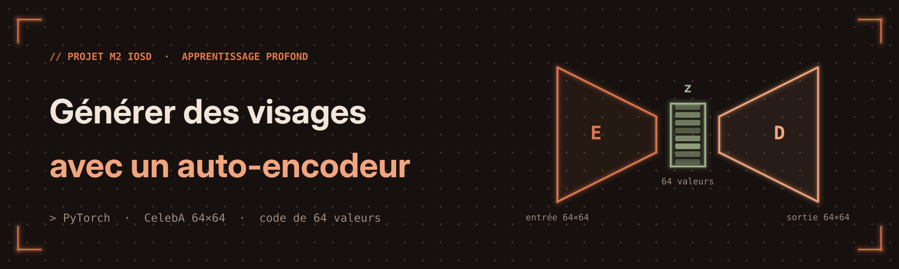
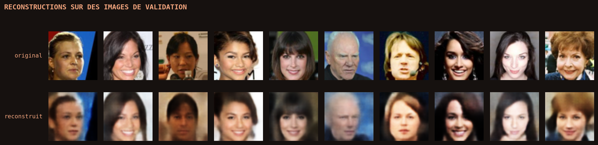
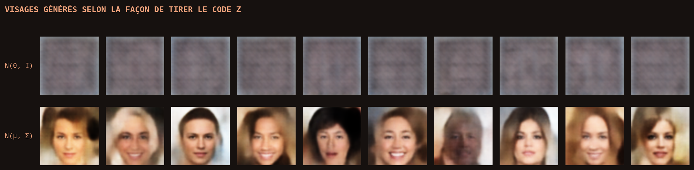
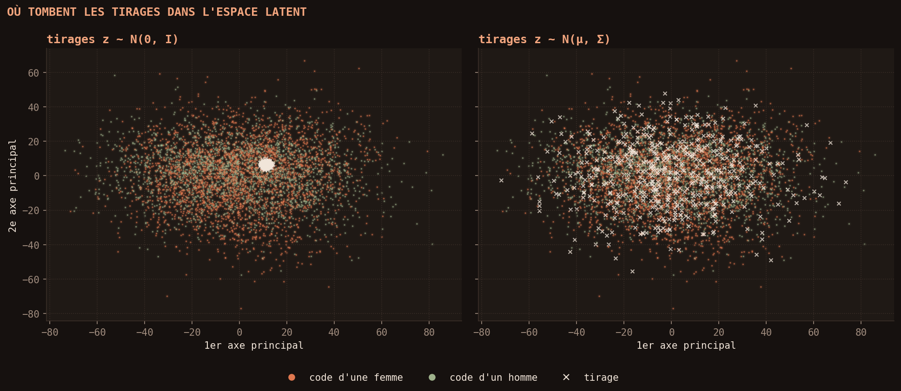

<p align="center">
  
</p>

<p align="center">
  
  
  
  
</p>

# Générer des visages avec un auto-encodeur convolutif

Projet de Master 2 IOSD (Image, Optimisation et Sciences des Données), Université de Bordeaux, réalisé en groupe de quatre sur un semestre.

Un auto-encodeur apprend à compresser une photo de visage en un code de 64 valeurs, puis à la reconstruire. Une fois entraîné, on garde le décodeur pour générer de nouveaux visages à partir de codes tirés au hasard. Toute la question est de savoir **comment tirer ces codes**.

**[Voir le notebook](autoencodeur_visages.ipynb)** · [version mise en forme (nbviewer)](https://nbviewer.org/github/yayefatou-lam/autoencodeur-visages/blob/main/autoencodeur_visages.ipynb)

## En bref

- **Données :** 36 000 visages du jeu CelebA (30 000 pour l'entraînement, 3 000 pour la validation, 3 000 pour le test), recadrés et réduits en 64 × 64.
- **Modèle :** auto-encodeur convolutif en PyTorch (1,9 million de paramètres), entraîné en minimisant l'erreur de reconstruction, avec conservation de la meilleure époque sur la validation.
- **Génération :** comparaison d'un tirage naïf $z \sim \mathcal{N}(0, I)$ et d'une gaussienne ajustée sur les codes des images d'entraînement, évaluée par précision et rappel dans l'espace latent.
- **Méthode :** le jeu de test n'a servi à aucun choix, seulement à l'évaluation finale.

## Résultats

| | MSE par pixel |
|---|---:|
| Validation (meilleure époque) | 0,0071 |
| Test | 0,0073 |

**Reconstructions** (en haut les images originales, en bas leur reconstruction)



**Génération** : le tirage naïf échoue, la gaussienne ajustée sur les codes donne des visages reconnaissables.





## Modèles testés

Avant ce modèle, on a comparé des auto-encodeurs denses et convolutifs sur Fashion-MNIST : le réseau convolutif reconstruit le mieux, avec environ deux fois moins de paramètres. Sur les visages, on a ensuite testé des codes de taille 32, 64, 128 et 256. Plus le code est grand, meilleure est la reconstruction, mais moins les visages générés sont réalistes (précision de 34,5 % pour $k = 32$, 7,3 % pour $k = 256$). Le notebook présente $k = 64$, notre compromis entre les deux. Le détail est dans la section 2 du notebook.

## Lancer le notebook

Le notebook est prévu pour Google Colab avec un GPU (Exécution > Modifier le type d'exécution > GPU). Les données sont téléchargées automatiquement depuis Hugging Face ([`tpremoli/CelebA-attrs`](https://huggingface.co/datasets/tpremoli/CelebA-attrs)) et ne sont pas incluses dans ce dépôt.

En local :

```bash
pip install -r requirements.txt
jupyter notebook autoencodeur_visages.ipynb
```

## Suite du projet

1. Modéliser la loi des codes par un **mélange de gaussiennes**, dont le nombre de composantes est choisi sur la validation.
2. Entraîner un **auto-encodeur variationnel (VAE)**, qui force les codes à suivre $\mathcal{N}(0, I)$ pendant l'entraînement.

## Auteurs

- **Yaye Fatou Lam** · [LinkedIn](https://www.linkedin.com/in/yaye-fatou-lam-258925412)
- **Imad Asennane**
- **Serigne Touba Mbaye**
- **Ndèye Marème Gueye**

## Données

CelebA : Z. Liu, P. Luo, X. Wang, X. Tang, *Deep Learning Face Attributes in the Wild*, ICCV 2015. Jeu de données réservé à un usage non commercial de recherche et d'enseignement.
